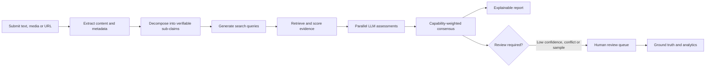
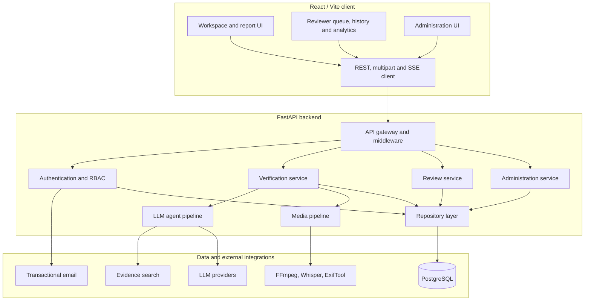
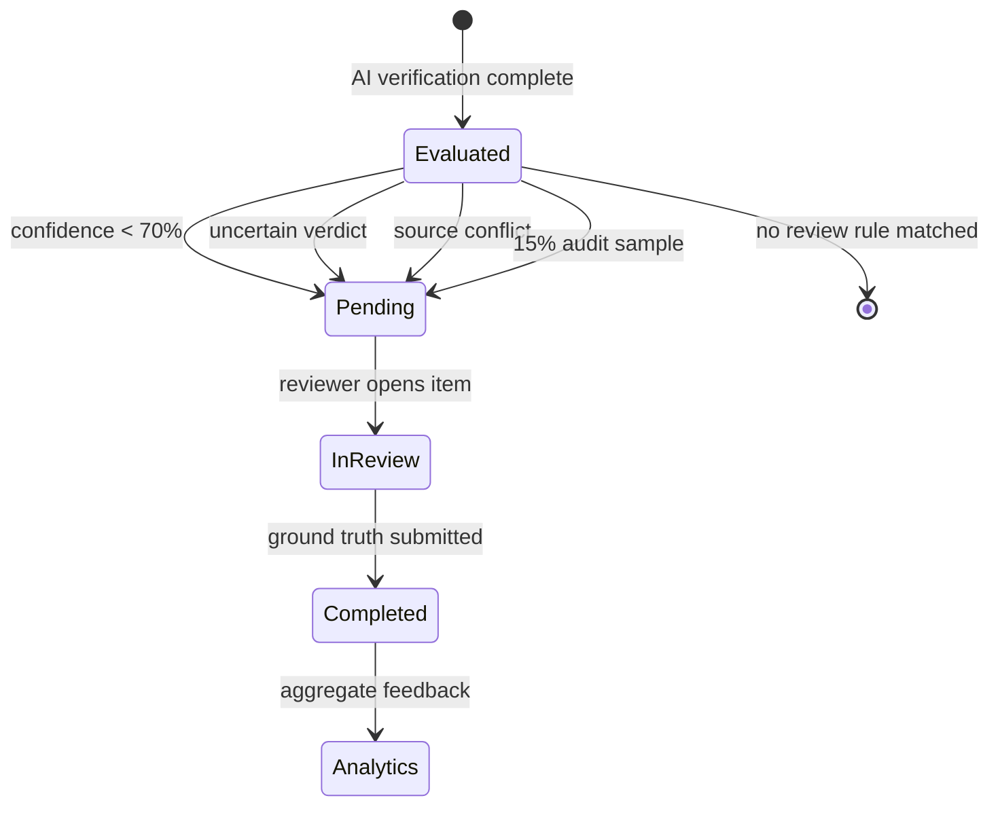
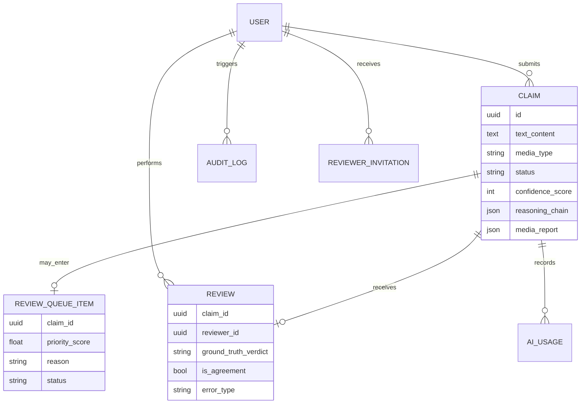

# VeriFact

### Explainable, multimodal fact-checking with LLM agents and human review

[](#)
[](#)
[](#)

**Portfolio case study by [Kunyu Li](https://github.com/like-rich)** · [中文版本](README.zh-CN.md)

VeriFact is an explainable fact-checking platform for text, images, audio, video, URLs, and supported online-video links. It decomposes an input into verifiable claims, retrieves web evidence, asks multiple LLMs for structured assessments, and produces an auditable report with verdicts, confidence scores, reasoning, and source links.

When an AI result is uncertain or contradictory, a human-in-the-loop workflow routes it to a reviewer instead of treating the model output as ground truth.

> This repository is a **public portfolio and architecture case study**. The implementation remains in a private UNSW team repository and is not reproduced here. See [Academic integrity and attribution](#academic-integrity-and-attribution).

## At a glance

| | |
| --- | --- |
| **Project** | UNSW COMP9900 Capstone Project (team project) |
| **Course result** | 87/100 — High Distinction |
| **My focus** | AI verification pipeline, evidence quality, weighted consensus, reviewer workflow and analytics |
| **Backend** | FastAPI, Pydantic, async SQLAlchemy, Alembic, PostgreSQL |
| **Frontend** | React, Vite, React Router, Axios, Recharts |
| **AI and retrieval** | LangChain, multiple OpenAI-compatible providers, Tavily / DuckDuckGo |
| **Delivery** | Docker Compose, GitHub Actions, pytest, ESLint, Ruff |

## The problem

Fact-checking with a single language model creates three practical risks:

1. A complex statement may contain several independently true or false claims.
2. A fluent answer can still rely on weak, outdated, or fabricated evidence.
3. A confidence score is not a substitute for accountable human review.

VeriFact addresses these risks with claim decomposition, evidence-first verification, cross-model comparison, source-aware confidence, and a review queue for ambiguous cases.

## Product workflow



The user sees live stage updates through Server-Sent Events (SSE), followed by a structured report. Each sub-claim retains its evidence summary, sources, reasoning, model agreement, verdict, and confidence.

## System architecture



The backend uses a **router → service → repository → model** structure. API concerns, business rules, data access, and persistence are separated so that the AI workflow and reviewer workflow can evolve independently.

More detail: [Architecture and design decisions](docs/ARCHITECTURE.md)

## My contributions

My work centred on the AI verification core and the human-review feedback loop.

### 1. Evidence-first AI verification pipeline

- Built the backend agent workflow that decomposes a statement into 1–5 independently verifiable sub-claims.
- Added parallel multi-query evidence retrieval and URL-aware evidence handling.
- Designed structured LLM outputs for verdict, confidence, reasoning, evidence summary, source URLs, and uncertainty disclaimers.
- Implemented graceful failure behaviour: missing or unusable evidence produces an `Uncertain` result instead of an invented answer.

### 2. Source quality and multi-model consensus

- Developed trusted-source classification and evidence annotation used before model assessment.
- Implemented parallel checks across configured model providers.
- Designed capability-weighted consensus with disagreement handling, confidence penalties, and a supermajority rule.
- Added claim-level aggregation from multiple sub-claim verdicts into a final `Supported`, `Refuted`, or `Uncertain` result.

### 3. Human-in-the-loop reviewer system

- Designed and implemented the reviewer domain across PostgreSQL models, Alembic migrations, repository, service, API, and React UI layers.
- Built smart queue routing for results with confidence below 70%, uncertain verdicts, conflicting evidence, and a 15% audit sample of high-confidence results.
- Added reviewer queue, review history, ground-truth decisions, disagreement categorisation, and notes.
- Built an AI performance dashboard with agreement rate, false-confidence rate, confusion matrix, calibration data, error distribution, and queue metrics.

### 4. Integration and documentation

- Integrated review routing with both standard and streamed verification paths.
- Connected reviewer pages and APIs to the wider application navigation and report flow.
- Wrote the root project documentation covering architecture, configuration, local setup, and Docker deployment.

See [Detailed contribution record](docs/MY_CONTRIBUTIONS.md) for ownership boundaries and the implementation evidence used to prepare this portfolio.

## Engineering highlights

| Challenge | Design response |
| --- | --- |
| Complex input contains several claims | Decompose into self-contained, searchable sub-claims |
| Search results vary in quality | Annotate source credibility and exclude unusable evidence |
| Models disagree | Preserve per-model results and compute a weighted consensus |
| No credible evidence exists | Return `Uncertain` with an explicit disclaimer |
| Long-running verification feels opaque | Stream stage and partial-result events over SSE |
| AI confidence can be misleading | Route risky and sampled results to human reviewers |
| Review data is hard to learn from | Aggregate calibration, confusion, agreement, and error metrics |
| External services can fail | Isolate integrations and degrade without fabricating results |

## Reviewer workflow



The review layer does more than provide a manual override. It creates labelled feedback for inspecting failure modes such as evidence hallucination, reasoning error, and source bias.

## API design snapshot

The versioned API is organised around four domains:

| Domain | Representative responsibilities |
| --- | --- |
| `/api/v1/auth` | Registration, activation, login, password recovery |
| `/api/v1/verify` | Text/media submission, SSE progress, history and reports |
| `/api/v1/reviewer` | Queue, ground-truth submission, history and analytics |
| `/api/v1/admin` | Users, claims, moderation, audit and usage metrics |

Example SSE lifecycle:

```text
event: stage_start
data: {"type":"stage_start","stage":"searching","message":"Searching for evidence"}

event: partial
data: {"type":"partial","concept_idx":0,"data":{"verdict":"Supported","confidence":84}}

event: complete
data: {"type":"complete","result":{"status":"Supported","confidence_score":81}}
```

The public example is intentionally abbreviated. See [API design](docs/API_DESIGN.md) for request boundaries, security controls, and error behaviour.

## Conceptual data model



More detail: [Data model](docs/DATA_MODEL.md)

## Technology stack

| Layer | Technologies |
| --- | --- |
| Frontend | React, Vite, React Router, Axios, Recharts, CSS |
| Backend | Python, FastAPI, Pydantic, Uvicorn |
| Persistence | PostgreSQL, async SQLAlchemy, Alembic |
| AI orchestration | LangChain, OpenAI-compatible providers, structured output parsing |
| Retrieval | Tavily, DuckDuckGo fallback, URL extraction |
| Media | Faster Whisper / OpenAI ASR, FFmpeg/FFprobe, yt-dlp, ExifTool, optional C2PA tooling |
| Security | JWT, bcrypt, RBAC, rate limiting, input sanitisation, SSRF-aware fetching |
| Quality and delivery | pytest, pytest-cov, ESLint, Ruff, Docker Compose, GitHub Actions |

## Scope and limitations

- AI verdicts are decision support, not a replacement for professional fact-checkers.
- Search coverage and source availability affect the strength of every result.
- Model confidence is calibrated heuristically and must remain visible to reviewers.
- Media provenance signals can indicate inconsistency but cannot prove authenticity alone.
- The capstone system is a prototype; production deployment would require stronger observability, secret management, object storage, abuse controls, and evaluation datasets.

## Academic integrity and attribution

VeriFact was created as a **collaborative UNSW COMP9900 team project**. Product-level descriptions in this portfolio refer to the team system. The section [My contributions](#my-contributions) describes work attributable to **Kunyu Li (`like-rich`)** based on the private repository's branch and commit history.

To respect the university course context, team ownership, and academic-integrity obligations:

- this public repository contains documentation and high-level design material only;
- no private course source code, credentials, datasets, or team repository history is published;
- the original implementation remains in the private UNSW team repository; and
- implementation access can only be discussed subject to university policy and team permission.

## Author

**Kunyu Li** · [GitHub @like-rich](https://github.com/like-rich)

If you are reviewing this project for a role, the best starting points are [My contributions](docs/MY_CONTRIBUTIONS.md) and [Architecture](docs/ARCHITECTURE.md).
