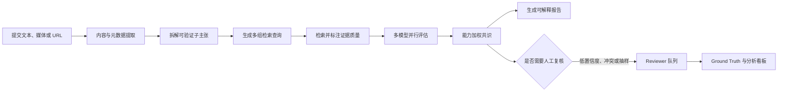
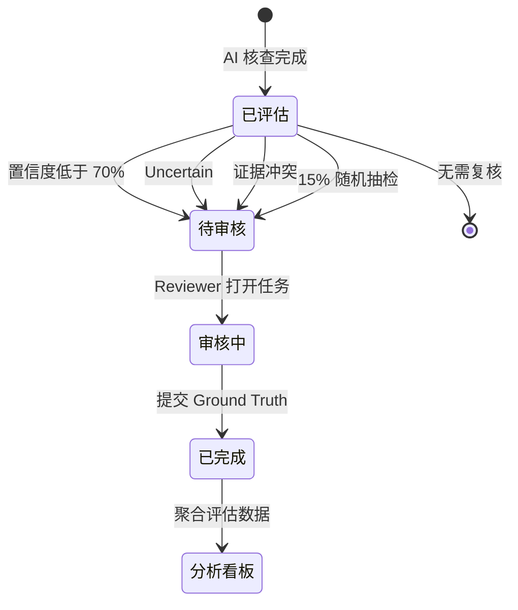

# VeriFact

### 基于多模型 Agent 与人工复核的可解释多模态事实核查平台

[English](README.md) · **作品集作者：[李坤宇（@like-rich）](https://github.com/like-rich)**

VeriFact 是一个支持文本、图片、音频、视频、网页 URL 与在线视频链接的事实核查平台。系统会将复杂输入拆解为可独立验证的子主张，检索网络证据，由多个 LLM 并行评估，并输出包含结论、置信度、推理过程和来源链接的可审计报告。

当模型置信度较低、证据冲突或结果被抽样检查时，任务会进入 Reviewer 队列，由人工给出 Ground Truth 并沉淀为评估数据。

> 本仓库是公开的**项目作品集与架构案例**，不包含 UNSW 私有课程仓库中的实现源码。

## 项目概览

| | |
| --- | --- |
| **项目背景** | UNSW COMP9900 Capstone 团队项目 |
| **课程成绩** | 87/100，High Distinction |
| **我的重点** | AI 核查流水线、证据质量、多模型加权共识、Reviewer 工作流与评估看板 |
| **后端** | FastAPI、Pydantic、异步 SQLAlchemy、Alembic、PostgreSQL |
| **前端** | React、Vite、React Router、Axios、Recharts |
| **AI 与检索** | LangChain、多家 OpenAI-compatible 模型、Tavily / DuckDuckGo |
| **工程交付** | Docker Compose、GitHub Actions、pytest、ESLint、Ruff |

## 系统解决的问题

直接使用单一大模型进行事实核查存在三个明显问题：复杂陈述可能包含多个真假不同的子主张；模型可能生成看似合理但证据薄弱的回答；模型置信度也不能代替人工责任判断。

因此 VeriFact 采用以下思路：

1. 将输入拆解为 1–5 个可检索、可独立验证的子主张；
2. 先检索并评估证据，再让模型作出结构化判断；
3. 并行调用多个模型，保留分歧并计算能力加权共识；
4. 在无可靠证据时明确返回 `Uncertain`，而不是编造来源；
5. 将高风险结果送入人工复核，形成质量反馈闭环。

## 核心工作流

前端通过 SSE 实时显示概念提取、证据检索、模型验证等阶段，并在完成后展示结构化报告。

## 我的贡献

### AI 事实核查核心

- 实现后端 Agent 工作流，将输入拆分为 1–5 个独立子主张。
- 实现并行多查询证据检索、URL 证据处理与结构化模型输出。
- 定义结论、置信度、推理链、证据摘要、来源 URL 和风险提示等输出字段。
- 加入失败降级：没有可用证据时返回 `Uncertain`，避免生成虚假来源。

### 证据质量与多模型共识

- 开发可信来源分类与证据质量标注逻辑。
- 支持多个模型提供方并行评估同一子主张。
- 实现基于模型能力权重的投票、supermajority 规则、分歧惩罚和置信度聚合。
- 将多个子主张的结果聚合为最终 `Supported`、`Refuted` 或 `Uncertain` 结论。

### Human-in-the-loop Reviewer 系统

- 贯通 PostgreSQL 数据模型、Alembic 迁移、Repository、Service、FastAPI 路由和 React 页面。
- 设计智能入队规则：置信度低于 70%、不确定结论、来源冲突，以及对高置信度结果进行 15% 随机抽检。
- 实现审核队列、历史记录、Ground Truth、分歧错误分类和 Reviewer 备注。
- 实现 AI 评估看板，包括一致率、错误置信率、混淆矩阵、校准曲线、错误类型分布和队列指标。

### 系统集成与文档

- 将 Reviewer 入队逻辑同时接入普通核查与 SSE 流式核查流程。
- 完成 Reviewer 前后端接口、页面路由与原有报告流程的集成。
- 编写项目根文档，说明架构、环境配置、本地运行和 Docker 部署方式。

更具体的职责边界与提交依据见：[个人贡献说明](docs/MY_CONTRIBUTIONS.md)。

## Reviewer 工作流

Reviewer 模块不仅用于人工修正结论，也用于定位 `evidence_hallucination`、`reasoning_error` 和 `source_bias` 等系统性问题。

## 关键工程设计

| 挑战 | 设计方案 |
| --- | --- |
| 一个输入包含多个事实点 | 拆解为可独立检索的子主张 |
| 网络来源质量不一致 | 对来源可信度进行标注和过滤 |
| 多个模型意见不一致 | 保留模型级结果并计算加权共识 |
| 找不到可信证据 | 明确输出 `Uncertain` 和免责声明 |
| 长任务缺少即时反馈 | 使用 SSE 推送阶段进度与部分结果 |
| 高置信度仍可能出错 | 风险规则与随机抽检共同进入人工队列 |
| 人工审核结果难以利用 | 生成校准、混淆矩阵、一致率和错误分布 |

## 进一步阅读

- [系统架构与设计决策](docs/ARCHITECTURE.md)
- [个人贡献与职责边界](docs/MY_CONTRIBUTIONS.md)
- [API 设计](docs/API_DESIGN.md)
- [数据模型](docs/DATA_MODEL.md)

## 项目边界与诚信说明

VeriFact 是 **UNSW COMP9900 团队项目**。本作品集中的系统级介绍描述团队最终产品；“我的贡献”仅描述可以从私有仓库分支和提交历史归属于**李坤宇（`like-rich`）**的工作。

为遵守课程、团队协作与 Academic Integrity 要求，本仓库只公开高层设计和作品集文档，不公开私有课程源码、密钥、数据集或团队提交历史。原始实现仍保存在 UNSW 私有团队仓库中。

## 作者

**李坤宇 / Kunyu Li** · [GitHub @like-rich](https://github.com/like-rich)

招聘方建议优先阅读：[个人贡献说明](docs/MY_CONTRIBUTIONS.md) 与 [系统架构](docs/ARCHITECTURE.md)。
