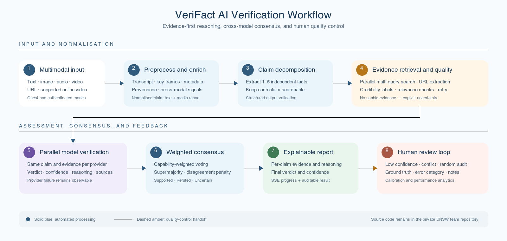

# VeriFact

### Explainable multimodal fact-checking with LLM agents and human review

[](#)
[](#)
[](#)

**Portfolio by [Kunyu Li (@like-rich)](https://github.com/like-rich)** · [中文首页](README.md)

VeriFact is an explainable fact-checking platform for text, images, audio, video, web URLs, and supported online-video links. It decomposes complex input into independently verifiable sub-claims, retrieves web evidence, asks multiple LLMs for parallel assessments, and applies capability-weighted consensus to produce an auditable report with verdicts, confidence, reasoning, and source links.

When a result has low confidence, conflicting evidence, or is selected for quality sampling, it enters a reviewer queue. Human ground truth then feeds an evaluation loop for monitoring AI behaviour.

> This repository is a public **portfolio and architecture case study**. The implementation remains in a private UNSW team repository; no course source code is reproduced here.

## Project visuals

### System architecture


The system combines a React/Vite client with a FastAPI backend organised into router, service, repository, and model layers. PostgreSQL persists users, verification results, human reviews, AI usage, and audit records. External boundaries integrate LLMs, evidence search, email, and local media tooling.

### AI agent workflow



The workflow follows an evidence-before-judgement principle. When credible evidence is unavailable or model disagreement is too high, the system returns `Uncertain` rather than an unsupported definitive answer.

> Product screenshots and a demo GIF will be added only after confirming permission to reuse team and course material. This portfolio does not substitute fabricated UI for real evidence.

## At a glance

| | |
| --- | --- |
| **Context** | UNSW COMP9900 Capstone team project |
| **Course result** | 87/100 — High Distinction |
| **My focus** | AI verification pipeline, evidence quality, multi-model consensus, reviewer workflow and analytics |
| **Backend** | Python, FastAPI, Pydantic, async SQLAlchemy, Alembic |
| **Database** | PostgreSQL, JSONB, versioned schema migrations |
| **Frontend** | React, Vite, React Router, Axios, Recharts |
| **AI and retrieval** | LangChain, multiple OpenAI-compatible providers, Tavily / DuckDuckGo |
| **Delivery** | Docker Compose, GitHub Actions, pytest, ESLint, Ruff |

## Core capabilities

- **Multimodal input:** text, image, audio, video, URL, and supported online video.
- **Claim decomposition:** split complex input into 1–5 independent, searchable facts.
- **Evidence retrieval:** run parallel queries and assess source quality.
- **Multi-model verification:** collect structured assessments from multiple LLMs.
- **Capability-weighted consensus:** preserve disagreement and aggregate with weights, confidence, and supermajority rules.
- **Live progress:** stream pipeline stages and partial results through Server-Sent Events.
- **Human review:** route low-confidence, uncertain, conflicting, and sampled results to reviewers.
- **Evaluation analytics:** agreement, false-confidence rate, confusion matrix, calibration, and error categories.
- **Role-based product areas:** separate user, reviewer, and administrator experiences.
- **Containerised delivery:** orchestrate frontend, backend, and PostgreSQL with Docker Compose.

## Technical architecture

```text
React / Vite SPA
       │ REST · multipart · SSE
       ▼
FastAPI Gateway + Middleware
       │
       ├── Auth Service
       ├── Verification Service ── AI Agent / Media Pipeline
       ├── Review Service ──────── Smart Queue / Analytics
       └── Admin Service
                  │
       Repository Layer + SQLAlchemy
                  │
             PostgreSQL 16
```

The layered backend separates HTTP concerns, business rules, data access, and persistence. AI providers, search services, and media tools sit behind explicit boundaries so failures can degrade safely without creating false success inside core business logic.

Details: [System architecture](docs/architecture.md) · [Backend design](docs/backend-design.md)

## AI agent workflow

1. **Normalise input:** extract text, transcript, key frames, metadata, and provenance information.
2. **Decompose claims:** produce 1–5 self-contained, searchable sub-claims.
3. **Retrieve evidence in parallel:** create multiple queries per claim and broaden weak searches.
4. **Annotate source quality:** identify credibility, relevance, and timeliness before assessment.
5. **Request independent model judgements:** require validated fields instead of unrestricted prose.
6. **Compute weighted consensus:** combine capability weights, confidence, agreement, and evidence overlap.
7. **Aggregate the global result:** produce `Supported`, `Refuted`, or `Uncertain`.
8. **Close the human feedback loop:** route risky cases and generate quality analytics.

Details: [AI workflow and consensus](docs/ai-workflow.md)

## Selected engineering details

### Evidence-first and source-aware verification

Models are not asked to answer only from parametric memory. Each assessment is grounded in retrieved material, and final source URLs must originate from that material. If usable sources are absent, the system lowers the strength of the conclusion and returns an explicit disclaimer.

### Parallel models and weighted consensus

Configured models independently receive the same sub-claim and evidence. The system preserves provider-level outputs and applies capability weights plus a weighted two-thirds supermajority rule. Model disagreement reduces final confidence.

### SSE progress streaming

Search and model calls have variable latency. SSE events such as `stage_start`, `stage_done`, `partial`, and `complete` show progress before the final report is ready.

### Human-in-the-loop quality control

The queue combines risk-based routing with random audit: confidence below 70%, uncertain outcomes, evidence conflict, and a 15% sample of high-confidence results. Sampling apparently safe predictions is necessary to discover confidently wrong output.

### Data and migrations

PostgreSQL stores relational business data, while JSONB holds evolving reasoning chains and media reports. Alembic provides traceable schema versions. Queue state and durable human judgements remain separate so routing policy and ground-truth data can evolve independently.

## My contributions

The following scope is based on branches, authored commits, and file-level differences associated with `like-rich` / Kunyu Li in the private repository.

### AI fact-checking backend

- Implemented the core agent orchestration and sub-claim decomposition.
- Added parallel multi-query retrieval, URL evidence handling, and failure degradation.
- Defined structured outputs for verdict, confidence, evidence, reasoning, sources, and disclaimers.
- Implemented aggregation from provider results to sub-claim consensus and global verdict.

### Source quality and multi-model verification

- Developed source-credibility classification and evidence annotation.
- Integrated multiple compatible providers for parallel assessment.
- Implemented capability-weighted voting, supermajority rules, disagreement penalties, and uncertainty handling.

### Reviewer workflow and evaluation dashboard

- Delivered the workflow across models, Alembic migrations, repositories, services, FastAPI routes, and React pages.
- Implemented smart routing, ground truth, review history, error categories, and duplicate-review protection.
- Added AI–human agreement, false-confidence, confusion-matrix, calibration, and error-distribution analytics.
- Connected queue routing to both standard and SSE verification paths.

### Integration and project documentation

- Integrated reviewer pages, APIs, navigation, and report flows.
- Authored root documentation for architecture, configuration, local execution, and Docker deployment.

Full ownership boundary and implementation record: [My contributions](docs/my-contributions.md)

## Team ownership boundary

VeriFact was a team project. Authentication, administration, the media-processing pipeline, parts of the frontend foundation, and later security hardening include substantial work by other members. These team-level capabilities appear here to explain the finished system, but they are not presented as my independent work.

## Outcomes

- Delivered an end-to-end multimodal fact-checking prototype.
- Combined multi-model verification, evidence quality, and human review into one feedback loop.
- Provided a reproducible three-service environment with Docker Compose.
- Integrated REST, SSE, migrations, reviewer analytics, frontend, and backend flows.
- Achieved a **87/100 High Distinction** result in UNSW COMP9900.

## Documentation

| Document | Coverage |
| --- | --- |
| [System architecture](docs/architecture.md) | Components, data flow, deployment, and trade-offs |
| [AI workflow](docs/ai-workflow.md) | Decomposition, retrieval, model assessment, and consensus |
| [Backend design](docs/backend-design.md) | Layering, async boundaries, reliability, and security |
| [Database design](docs/database-design.md) | Conceptual ER model, JSONB, queue, and review records |
| [API design](docs/api-design.md) | REST, SSE, authentication, errors, and reviewer endpoints |
| [My contributions](docs/my-contributions.md) | Individual scope, implementation evidence, and team boundary |

## Source code and academic integrity

VeriFact is a **collaborative UNSW COMP9900 course project**. To respect course policy, team ownership, and academic-integrity obligations:

- this repository contains portfolio documentation, diagrams, and high-level design only;
- no private source code, credentials, datasets, or team Git history is published;
- the implementation remains in the private UNSW team repository; and
- releasing selected personal code will be considered only after confirming university policy and team permission.

No open-source licence is included at this stage. The absence of a licence does not grant permission to copy, modify, or redistribute the material.

## Author

**Kunyu Li** · [GitHub @like-rich](https://github.com/like-rich)

For a backend or AI application engineering review, start with [My contributions](docs/my-contributions.md), [AI workflow](docs/ai-workflow.md), and [Backend design](docs/backend-design.md).
