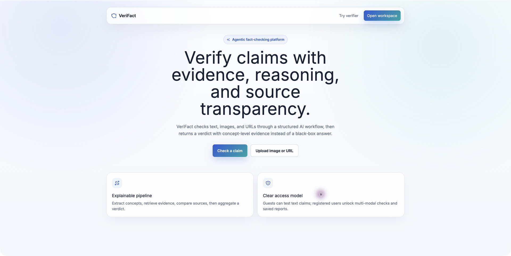
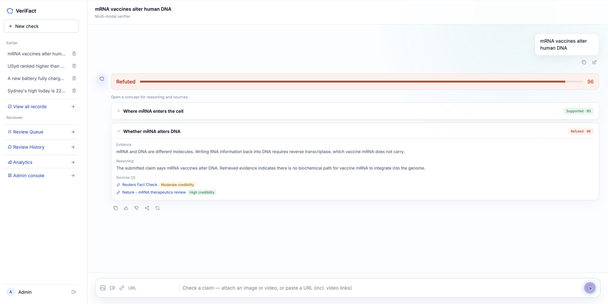
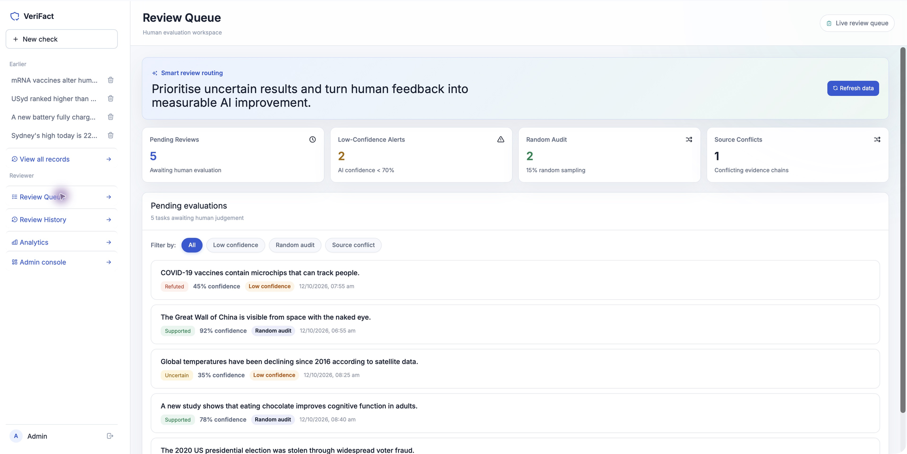
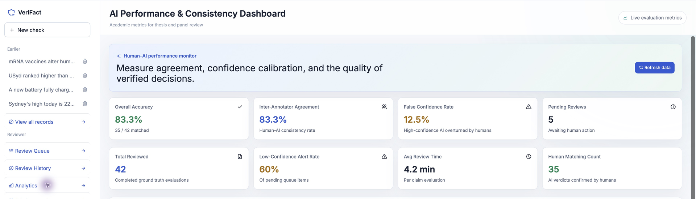
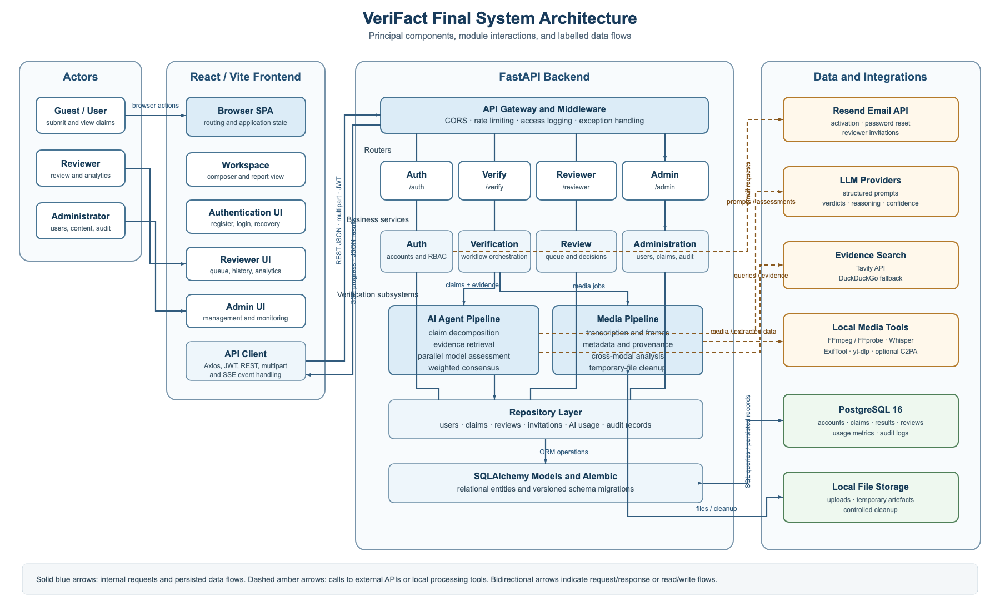

# VeriFact

### Explainable multimodal fact-checking with LLM agents and human review

**Author: [Kunyu Li (@like-rich)](https://github.com/like-rich)** · [中文首页](README.md)

VeriFact fact-checks text, images, audio, video, and URLs. It decomposes independently verifiable sub-claims, retrieves web evidence, asks multiple LLMs for structured assessments, and applies capability-weighted consensus to produce a report with verdicts, confidence, reasoning, and sources. Risky results enter a human reviewer queue.

> This is a public portfolio. The implementation remains in a private UNSW team repository; no course source code is reproduced here.

## Project and stack

| | |
| --- | --- |
| **Context** | UNSW COMP9900 Capstone team project |
| **Backend** | Python, FastAPI, Pydantic, async SQLAlchemy, Alembic |
| **Frontend** | React, Vite, Axios, Recharts |
| **Data and AI** | PostgreSQL, LangChain, multiple OpenAI-compatible models |
| **Retrieval and media** | Tavily / DuckDuckGo, FFmpeg, Whisper, ExifTool, yt-dlp |
| **Delivery and quality** | Docker Compose, GitHub Actions, pytest, Vitest, ESLint, Ruff |

## Product preview

These captures show the project's actual React frontend running locally with built-in **mock data**. Permission to publish the interface material has been confirmed. Verdicts, source links, confidence values, and dashboard numbers are demonstration fixtures, not evidence of a live LLM run or measured evaluation performance.

*30-second screenshot sequence: claim input → verification report → reviewer queue and workbench → analytics.*

| Landing page | AI verification report |
| --- | --- |
|  |  |
| **Reviewer queue** | **AI evaluation dashboard (metric area)** |
|  |  |

[Review workbench](assets/reviewer-workbench.png) · [Capture details and demo scope](docs/product-demo.md)

## My contributions

- **AI fact-checking backend:** claim decomposition, parallel evidence retrieval, structured model assessment, and global aggregation.
- **Multi-model consensus:** source-quality annotation, capability-weighted voting, supermajority, disagreement penalties, and uncertainty handling.
- **Reviewer workflow:** database migrations, repositories, services, FastAPI, React queue, and evaluation dashboard.
- **System integration:** smart routing in standard and SSE verification, plus reviewer pages, APIs, and report integration.

Public technical evidence: [Contribution record](docs/my-contributions.md) · [Consensus pseudocode](docs/consensus-algorithm.md) · [Reviewer smart queue](docs/reviewer-queue.md)

VeriFact was a team project. Authentication, administration, the media pipeline, parts of the frontend foundation, and later security hardening include substantial work by other members and are not presented as my independent work.

## System architecture

React/Vite communicates with FastAPI through REST, multipart, and SSE. The backend follows Router → Service → Repository → Model layering, while PostgreSQL stores verification, review, AI-usage, and audit data.

[Full architecture](docs/architecture.md) · [Backend design](docs/backend-design.md)

## Engineering highlights

| Area | Implementation summary |
| --- | --- |
| **Multi-model fact-checking** | LangChain orchestration for decomposition, parallel retrieval, structured verification, and weighted consensus |
| **Evidence-first design** | Source-quality annotation; return `Uncertain` instead of inventing citations when evidence is unusable |
| **Streaming** | SSE events: `stage_start`, `stage_done`, `partial`, and `complete` |
| **Human-in-the-loop** | Low-confidence, conflicting, and 15%-sampled high-confidence results enter review |
| **Backend engineering** | Layering, async persistence, migrations, transaction ordering, caching, and Docker delivery |

[Full AI workflow](docs/ai-workflow.md)

## Outcomes

- Delivered an end-to-end multimodal fact-checking and human-quality feedback loop.
- Automated suites: **18 backend + 17 frontend = 35 passing tests**; [scope and limitations](docs/test-results.md).
- **UNSW COMP9900 Course Result: 87/100 (High Distinction)**.

This is my individual final course result, not a claim that the team project received a separate score of 87.

## Technical documentation

| Document | Coverage |
| --- | --- |
| [AI workflow](docs/ai-workflow.md) | Decomposition, retrieval, assessment, aggregation, and failures |
| [Consensus algorithm](docs/consensus-algorithm.md) | Pseudocode, worked example, complexity, and alternatives |
| [Reviewer smart queue](docs/reviewer-queue.md) | Routing, state, transaction, and production improvements |
| [API design review](docs/api-design.md) | Verified contracts separated from recommendations |
| [Backend and database](docs/backend-design.md) | Layering, concurrency, reliability, security, and data model |
| [My contributions](docs/my-contributions.md) | Individual evidence and team ownership boundary |

## Source and permission notice

This repository publishes portfolio documentation, diagrams, and interface screenshots and a GIF confirmed for public use. Source code remains in the private UNSW team repository. Credentials, real user data, private datasets, and team Git history are excluded. Publishing personal source code requires separate permission.

No open-source licence is included at this stage. The absence of a licence does not grant permission to copy, modify, or redistribute the material.

**Kunyu Li** · [GitHub @like-rich](https://github.com/like-rich)
