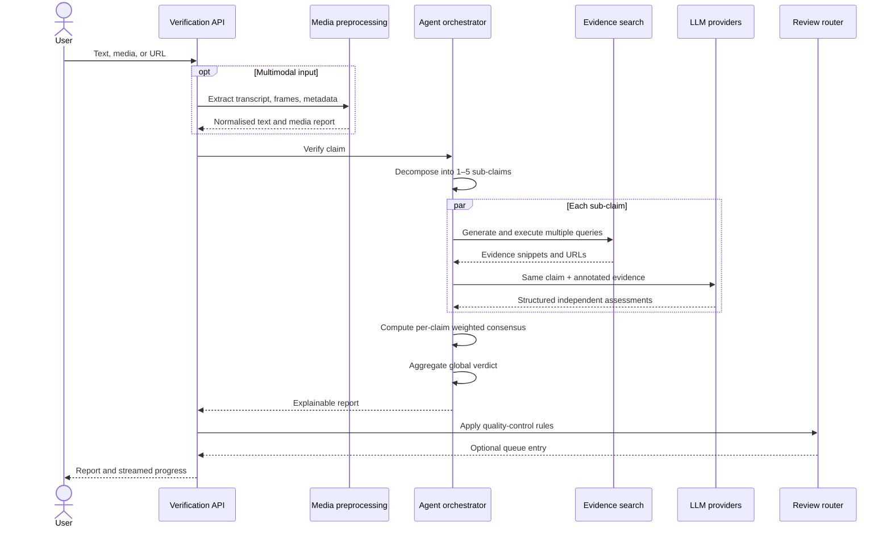

# AI workflow and consensus design

[← 中文首页](../README.md) · [English home](../README_EN.md)

## Design goal

VeriFact is designed to answer a narrower question than a general chatbot: **what can the available evidence support, refute, or leave unresolved?**

The pipeline separates retrieval, assessment, consensus, and human review so that each decision remains inspectable.

## End-to-end flow



## 1. Input normalisation

All modalities are converted into text and structured context before verification.

| Input | Normalised information |
| --- | --- |
| Text | Original statement |
| Image | Visual description and available provenance metadata |
| Audio | Transcript and media metadata |
| Video | Transcript, sampled frames, metadata, and cross-modal observations |
| URL | Extracted page content and source URL |
| Online video | Metadata and, when enabled, downloaded media analysis |

The binary media itself is not passed through every later stage. The agent operates on bounded, inspectable representations.

## 2. Claim decomposition

A long statement may contain several factual assertions with different truth values. The decomposition stage creates 1–5 sub-claims that are:

- self-contained;
- specific enough to search;
- independently verifiable; and
- written in the user's language.

Bounding the count reduces runaway search and model cost while keeping mixed claims observable.

## 3. Evidence retrieval

Each sub-claim produces multiple search queries. Search work runs in parallel, and weak initial results can trigger a broader query.

Evidence processing records:

- result title, snippet, and URL;
- relevance to the exact sub-claim;
- source credibility category;
- timeliness where the claim is date-sensitive; and
- whether the source should be excluded from the final citation set.

Direct URLs are fetched through a guarded path rather than trusted automatically.

## 4. Structured model assessment

Every configured model receives the same sub-claim and annotated evidence. The response must match a validated structure:

```text
verdict
confidence
explanation and conclusion
reasoning steps
evidence summary
source URLs
search quality
uncertainty disclaimer
```

The three verdicts are:

- `Supported`: credible evidence confirms the sub-claim;
- `Refuted`: credible evidence contradicts the sub-claim; and
- `Uncertain`: evidence is missing, weak, conflicting, or insufficient.

Source URLs must be drawn from retrieved evidence. An empty source list is preferred to an invented citation.

## 5. Capability-weighted consensus

The prototype assigns a capability weight to each configured provider. For each verdict group, it calculates weighted confidence and total supporting weight.

Conceptually:

```text
weighted_confidence(verdict) =
    sum(model_confidence × provider_weight)
    / sum(provider_weight)

weighted_support(verdict) =
    sum(provider_weight for models choosing that verdict)
```

Decision order:

1. If one verdict reaches a weighted two-thirds supermajority, select it.
2. Otherwise, select a weighted plurality only with a disagreement penalty.
3. If evidence or confidence is too weak, return `Uncertain`.
4. Preserve model-level outputs for audit rather than discarding disagreement.

The weights are engineering policy, not objective truth. Production calibration would require a labelled evaluation set and periodic re-estimation.

## 6. Global aggregation

Per-sub-claim consensus is aggregated into the final report. High-confidence refutation has stronger impact because one materially false component can invalidate a compound statement. Low-confidence supported or refuted results are normalised toward uncertainty.

The report retains each sub-claim's:

- consensus verdict and confidence;
- evidence summary and selected sources;
- model agreement information;
- reasoning steps; and
- risk disclaimer.

## 7. Streaming progress

Search and model calls are network-bound and have variable duration. The streaming endpoint emits:

| Event | Meaning |
| --- | --- |
| `stage_start` | A pipeline stage has begun |
| `stage_done` | A stage completed successfully |
| `partial` | One sub-claim result is ready |
| `complete` | The aggregate report is ready and persisted |

The final database commit occurs before the `complete` event so the client can open the saved claim without a read-after-write race.

## 8. Human-review handoff

The smart router creates a queue item for:

- confidence below 70%;
- an `Uncertain` result;
- conflicting supported and refuted sub-claims; or
- 15% of otherwise high-confidence results.

The random sample is essential for observing false confidence. Reviewer decisions record agreement, error category, and optional notes, feeding calibration and error-distribution views.

## Failure behaviour

| Failure | Safe behaviour |
| --- | --- |
| Search returns no evidence | Skip unsupported judgement and return uncertainty |
| One model provider fails | Retain the failure and compute from remaining valid results |
| Structured parsing fails | Produce an explicit error branch, not guessed fields |
| Sources conflict | Reduce confidence and route for review |
| Stream worker fails | Return a safe fallback event and traceable server error |
| Repeated identical text | Reuse a short-lived query cache while persisting a new claim record |

## Limitations

- Search coverage is not equivalent to factual completeness.
- Provider confidence values are not directly calibrated probabilities.
- Source reputation cannot replace claim-level evidence analysis.
- The prototype's weights and thresholds require evaluation on a larger labelled dataset.
- Human review improves accountability but introduces workload, consistency, and reviewer-bias concerns.
