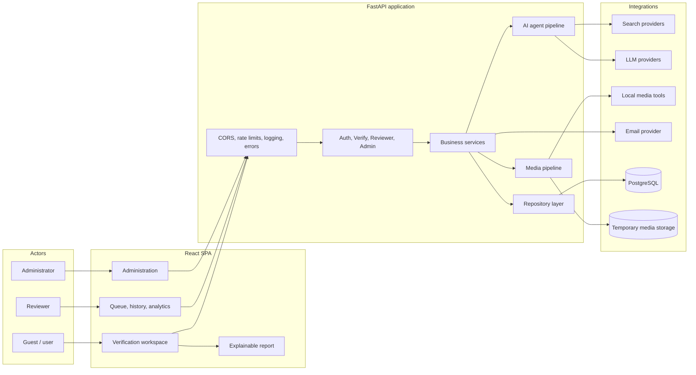
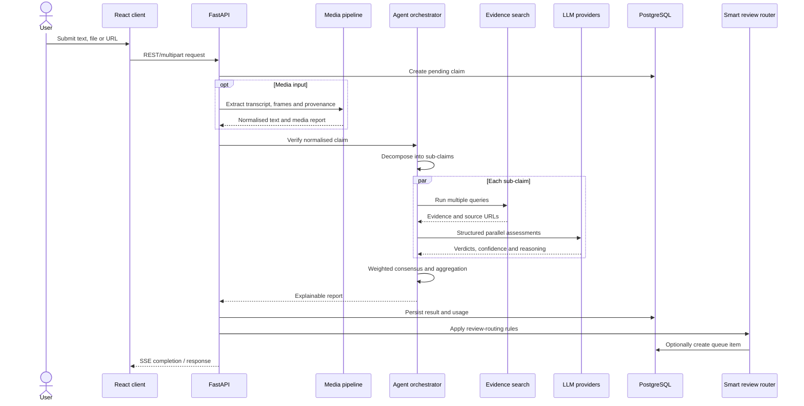
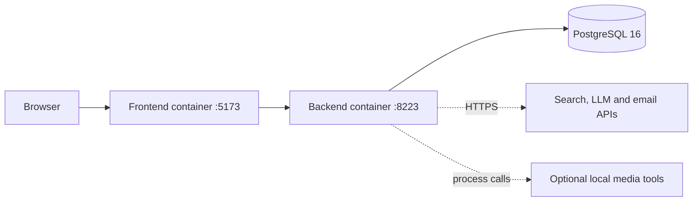

# Architecture and design decisions

[← 中文首页](../README.md) · [English home](../README_EN.md)

## Context

VeriFact accepts heterogeneous inputs, performs network and model calls with variable latency, and must present uncertain results honestly. The architecture separates deterministic application behaviour from probabilistic AI behaviour and adds human review as a first-class subsystem.

## Component view

## Verification sequence

## Key decisions

### Evidence before judgement

The judging model receives retrieved evidence rather than being asked to answer from parametric memory alone. Evidence is annotated with source-quality context, and final URLs must originate from the retrieved material.

**Trade-off:** retrieval adds latency and inherits search-engine coverage gaps. The system exposes uncertainty instead of hiding those gaps.

### Decompose before verifying

A single input can mix several factual assertions. Decomposition provides a verdict and evidence trail for each assertion before producing an overall result.

**Trade-off:** poor decomposition can distort later stages, so the structured output is bounded to a small number of self-contained sub-claims.

### Parallel model assessments

Configured providers assess the same sub-claim and evidence concurrently. The system retains model-level results, applies capability weights, and lowers confidence when models disagree.

**Trade-off:** multiple providers increase cost and operational variability. Usage metadata is recorded so cost and reliability can be monitored.

### Server-Sent Events for progress

Verification is server-driven and mainly one-way after submission, making SSE simpler than a bidirectional WebSocket channel. Stage and partial-result messages keep the UI responsive during network-bound work.

**Trade-off:** reconnection, cancellation, and intermediary timeouts require explicit handling in a production deployment.

### Human review as quality control

The review queue accepts risky cases and a random sample of apparently safe ones. Sampling high-confidence results is important because reviewing only uncertain outputs cannot measure overconfidence.

**Trade-off:** the 70% threshold and 15% sample rate are prototype policy values and should be tuned using workload and calibration data.

### Layered backend

Routers translate HTTP, services own business rules, repositories isolate data access, and ORM models define persistence. AI and external-service adapters remain behind service boundaries.

**Trade-off:** this introduces more files and interfaces than a small prototype strictly needs, but it supports testing and independent feature evolution.

## Reliability and security boundaries

- Pydantic schemas validate API and model-output structures.
- Model parsing or provider failures become explicit uncertain branches.
- JWTs are revalidated against the database so bans and role changes take effect immediately.
- Rate limits protect registration, login, and verification endpoints.
- URL fetching applies SSRF-aware validation.
- Prompt input is sanitised before interpolation.
- Media uploads are size-limited and temporary artefacts are cleaned up.
- Logs and audit records are separated from user-facing error details.
- Secrets are injected through environment variables and are not stored in this portfolio.

## Deployment topology

The capstone environment uses Docker Compose with three primary services:

The backend runs schema migrations before application startup. A production evolution would place a reverse proxy in front, use managed PostgreSQL and object storage, move heavy media work to background workers, and add traces and queue-level observability.
