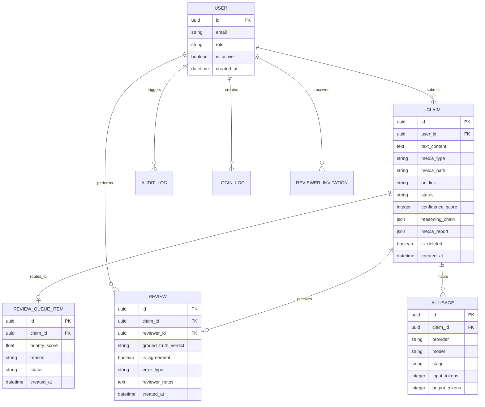
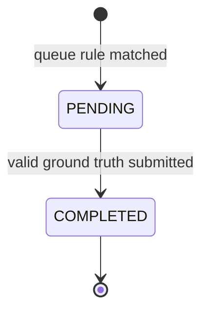

# Data model

[← 中文首页](../README.md) · [English home](../README_EN.md)

The production schema is managed through Alembic migrations. This page shows the conceptual entities relevant to the portfolio; it is not a schema dump from the private repository.

## Entity relationships

## Design notes

### Claims keep the explainability record

`reasoning_chain` stores structured per-sub-claim results, while `media_report` stores derived transcript, frame, provenance, and cross-modal information. PostgreSQL JSONB supports evolving AI payloads without splitting every nested field into a separate relational table.

The trade-off is weaker database-level validation for nested content, so Pydantic schemas validate the boundary before persistence.

### Queue state is separate from review evidence

`review_queue` represents operational work; the implemented flow uses `PENDING` and `COMPLETED`, while the model reserves `IN_REVIEW` for a future claim/lease workflow. `reviews` represents the durable human judgement. Keeping them separate allows queue policy to evolve without rewriting ground-truth data.

### One review per claim

The prototype enforces a unique review for each claim. This prevents double submission and simplifies analytics. A production annotation system could instead allow multiple independent reviews and calculate inter-reviewer agreement.

### Deletion is non-destructive

Claim moderation uses a soft-delete flag so administrators can restore content and retain auditability. Hard deletion is reserved for explicit retention or privacy requirements.

### Usage and audit data are first-class

AI calls record provider, model, stage, tokens, and estimated cost data. Administrative actions and access events are recorded separately. This supports operational monitoring without embedding infrastructure details into the user-facing claim model.

## Reviewer state transition

A transaction creates the human review and completes the associated queue item together, avoiding a state where a decision exists but the task still appears pending. Although `IN_REVIEW` is present in the model comment, no current endpoint transitions into it.
