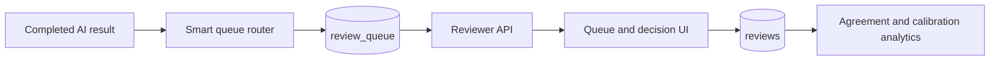
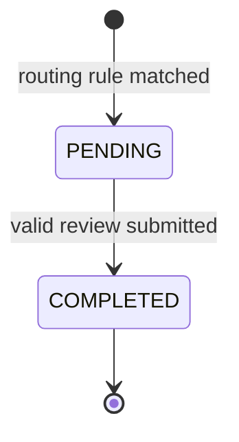

# Reviewer smart queue

[← 中文首页](../README.md) · [English home](../README_EN.md)

> This is an independently written design explanation of the module I implemented. It contains no private course source code.

## Purpose

The reviewer subsystem converts selected AI results into accountable human decisions and measurable quality signals. It joins five backend concerns:



## Verified routing policy

Rules are evaluated in priority order:

| Priority | Condition | Stored reason | Priority score |
| ---: | --- | --- | ---: |
| 1 | Confidence below 70% or verdict is `Uncertain` | `LOW_CONFIDENCE` | `100 - confidence` |
| 2 | Reasoning chain contains both supported and refuted sub-claims | `SOURCE_CONFLICT` | `90 - confidence` |
| 3 | 15% sample of remaining high-confidence claims | `RANDOM_SAMPLING` | `100 - confidence` |

Because the checks use `if / elif`, each claim receives at most one routing reason. A unique claim constraint and an existence check prevent duplicate queue entries.

## Independently written routing pseudocode

```text
function route(claim):
    if queue already contains claim.id:
        return existing item

    confidence = claim.confidence or 0
    verdict = claim.verdict or Uncertain

    if confidence < 70 or verdict == Uncertain:
        reason = LOW_CONFIDENCE
        priority = 100 - confidence

    else if reasoning contains both Supported and Refuted:
        reason = SOURCE_CONFLICT
        priority = 90 - confidence

    else if random() < 0.15:
        reason = RANDOM_SAMPLING
        priority = 100 - confidence

    else:
        return no queue item

    insert unique queue item in PENDING state
```

Randomly sampling high-confidence results matters because a queue containing only admitted uncertainty cannot measure confident errors.

## Data separation

### Queue item

Represents operational work:

```text
claim_id · priority_score · reason · status · created_at
```

### Human review

Represents the durable annotation:

```text
claim_id · reviewer_id · ground_truth_verdict
is_agreement · error_type · reviewer_notes · timestamps
```

Keeping these concepts separate allows routing policy to change without rewriting completed ground-truth records.

## Implemented state transition



The database model reserves `IN_REVIEW`, but the current API does not claim or lease an item when a reviewer opens it. The implemented service transitions a queue item directly to `COMPLETED` after creating the review.

This distinction is important in an interview: `IN_REVIEW` is a modelled future state, not a fully implemented concurrency control.

## Submission transaction

The service performs the following logical steps:

1. Load the claim and reject a missing target.
2. Check whether a review already exists.
3. Compare the lower-cased AI and human verdicts.
4. Store an error category only when they disagree.
5. Insert the human review.
6. Mark the matching queue item `COMPLETED`.
7. Commit the unit of work.

A unique database constraint on `reviews.claim_id` provides final duplicate protection if two submissions race past the service-level existence check.

## Reviewer API surface

| Endpoint | Responsibility |
| --- | --- |
| `GET /api/v1/reviewer/queue` | Paginated pending work with reason and confidence filters |
| `POST /api/v1/reviewer/review` | Ground-truth decision, error type, and notes |
| `GET /api/v1/reviewer/history` | Completed AI-versus-human comparisons |
| `GET /api/v1/reviewer/analytics` | Accuracy, false confidence, calibration, errors, and workload |

Reviewer and administrator roles may access these routes.

## Analytics produced

| Metric | Engineering purpose |
| --- | --- |
| AI–human agreement | Basic outcome quality |
| False-confidence rate | High-confidence results rejected by humans |
| Confusion matrix | Systematic class confusion |
| Calibration curve | Confidence versus observed agreement |
| Error-type distribution | Evidence, reasoning, and source-bias failure modes |
| Pending count and average review time | Operational reviewer workload |

## Design alternatives

| Choice | Current prototype | Production alternative |
| --- | --- | --- |
| Assignment | Shared pending queue | Atomic claim/lease with expiry |
| Reviews per claim | One | Multiple independent annotations |
| Sampling rate | Fixed 15% | Capacity- and risk-aware adaptive sampling |
| Threshold | Fixed 70% | Calibration-derived threshold by domain |
| Conflict detection | Mixed sub-claim verdicts | Evidence-level contradiction classifier |
| Analytics labels | Reviewer verdict as ground truth | Adjudicated multi-reviewer consensus |

## Recommended production hardening

- Atomically claim queue items and implement the reserved `IN_REVIEW` state.
- Add lease expiry so abandoned tasks return to the pool.
- Support multiple reviewers and adjudication for high-impact claims.
- Record routing-policy version, reviewer latency, and decision revisions.
- Use `409 Conflict` for an already-reviewed claim.
- Restrict global review history if reviewers should only see assigned work.
- Monitor sampling fairness across topics, languages, and media types.
